# Google Glass 1.4.2

A ready-to-load Chrome Manifest V3 extension based on the supplied Google, Yandex, Translate, search-results and selector references. Includes HeroUI / NextUI controls, light and dark themes, uploaded backgrounds, Google AI Mode, YouTube and Gmail styling.

**Install:** [English](INSTALL.en.md) · [Русский](INSTALL.ru.md). Extract `Google-Glass.zip`, open `chrome://extensions`, enable Developer mode and load the inner `extension` folder. The archive contains compiled files; installation requires no Node.js or build step.

To install from GitHub, choose **Code → Download ZIP** and extract it, or clone this repository. Load its **`extension`** folder in Chrome. The compiled extension and all required assets are included.

The ZIP contains the ready-to-load extension and guides. Editable source, development scripts and QA evidence are available in the full project workspace.

## Translate state and Copy repair — 1.4.2

Translate now follows native `sl`/`tl` URL changes, browser history and textarea values even when Google produces no DOM mutation. The visible language pair and result no longer remain stale after navigation. Copy and Share use a direct-copy fallback when the site's Clipboard API permission is denied; no clipboard-reading permission is added. Clear also clears stale native output immediately.

Verified on the real Google Translate site with Russian → English (`Доброе утро` → `Good morning`) and a clipboard read after copying. The same isolated profile also exercised the installed `www.google.com` homepage's apps and shared settings modal. [Regression review](qa/translate-state-review.md) · [Live ru→en capture](qa/translate-live-ru-en.png).

Reload Google Glass at `chrome://extensions`, confirm **1.4.2**, then refresh existing Translate tabs. The previous 1.4.1 body-isolation change did not cover the URL/value synchronization and clipboard-denial cases; this release adds those regression checks.

## Installed-page interaction repair — 1.4.1

The Google, Translate and Yandex interfaces now mount outside the native page body. This prevents body-level capture handlers and inherited `inert` states from swallowing clicks, keystrokes and focus while the local preview remains interactive. The regression was reproduced with the previous placement and verified with real mouse/keyboard input after the fix.

**After updating:** reload **Google Glass** at `chrome://extensions`, confirm the latest version **1.4.2**, then close and reopen affected site tabs. Existing tabs keep their previously injected JavaScript until refreshed. The compiled folder in this workspace is `D:\Projects\google\extension`.

The installed root URL `https://translate.google.com/` was tested directly: apps, searchable languages, modal settings/save, keyboard, clear, input and real translation. See [the installed interaction review](qa/installed-interaction-review.md) and [browser capture](qa/translate-installed-interactions.png).

## Translate and Gmail repairs — new in 1.4

The Google Translate page follows the supplied reference: measured two-pane layout, glass gradients, Google-style icons, purple-blue Gemini mark and an Earth background. The side slogans are removed. It supports desktop/mobile layouts, dark/light/system themes, shared background uploads, searchable language selection, a keyboard, speech input and copying/sharing real translation results.

- **Sites → Translate** controls the theme on `translate.google.com` and `translate.google.ru`. It starts enabled, like the Google theme.
- **Appearance → New tab homepage → Translate** makes Translate the New Tab page. **Google remains the default**, and existing homepage preferences are preserved.
- On the actual Google Translate site, source text and language choices are forwarded to its native engine, and the real result appears in the HeroUI pane. Document, image and website modes use Google's existing workflows.
- New Tab and local previews open the official Translate service when you press **Translate** or Ctrl/Cmd+Enter. Translation text is not saved by the extension. Google processes translations through its own service.
- Gmail's sticky toolbar stays dark while scrolling, including native pseudo-element backgrounds. The logo no longer receives a search-field outline. Muted native icons remain visible and gold stars keep their color. Compose uses a reference-sampled blue gradient with a light pencil icon.

Preview: **http://127.0.0.1:4173/translate.html** after `npm.cmd run dev`. Reload the extension in `chrome://extensions`, allow the added Translate site access if requested, then refresh existing Gmail and Translate tabs.

## Yandex homepage — added in 1.3

Choose **Appearance → New tab homepage → Yandex** in the extension popup, or visit a supported Yandex homepage. Google remains the default for New Tab. The separate **Sites → Yandex** switch controls restyling on Yandex websites.

- Actual HeroUI search, buttons, glass cards, menus and animated settings/shortcut dialogs.
- Working Yandex search, seven service shortcuts, sign-in, Plus and Mail folder links.
- Dark, light and system themes, shared custom backgrounds and separate Yandex shortcut storage.
- Labeled sample weather with opt-in live hourly weather. The news card contains selected example topics; Mail opens the native service without reading a mailbox or inventing unread counts.
- Supported homepage domains: `ya.ru`, `yandex.ru`, `yandex.com`, `yandex.by` and `yandex.kz`, including `www`. Yandex results and CAPTCHA pages keep their native interface.

Local preview: **http://127.0.0.1:4173/yandex.html**. Run `npm.cmd run dev` from the source workspace first. Reload the extension and refresh existing tabs after upgrading; Chrome may request access to the newly supported Yandex sites.

## Screenshots

The following screenshots come from the project's browser QA captures.

### Yandex

| Dark | Light |
| --- | --- |
| 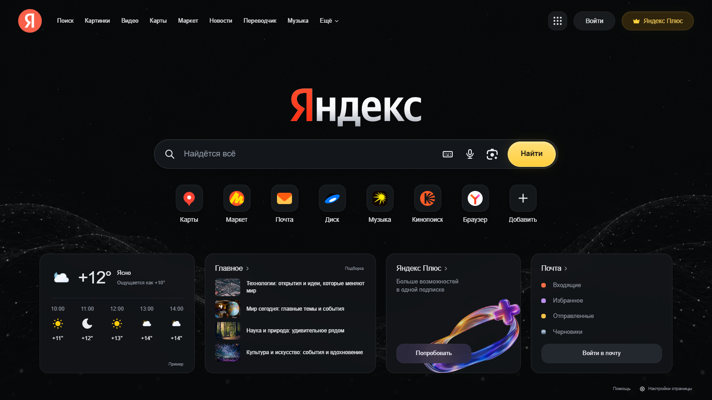 | 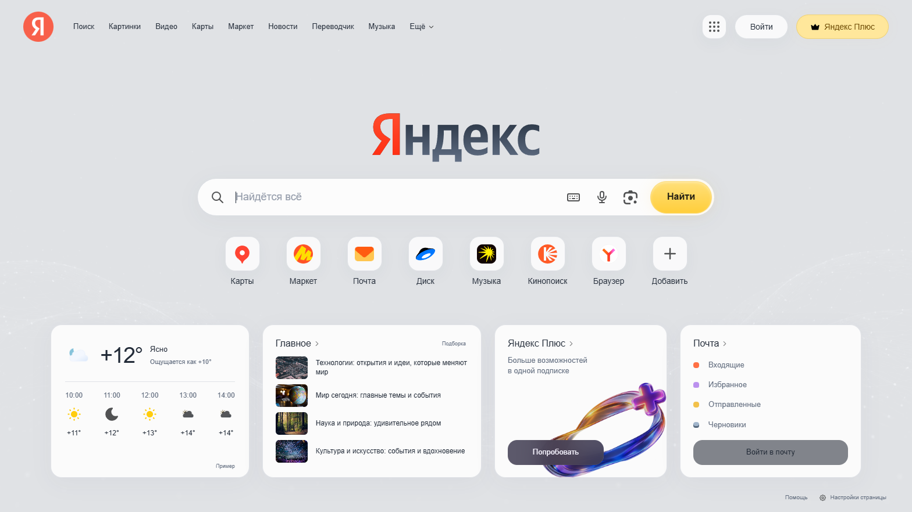 |

<details>
<summary>Yandex on mobile and its HeroUI settings</summary>

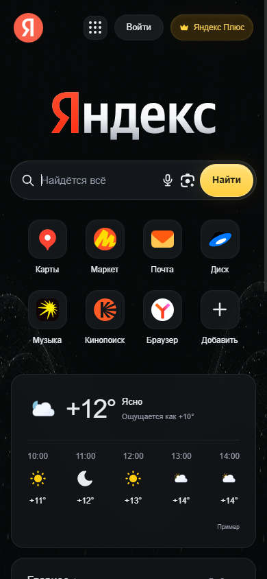
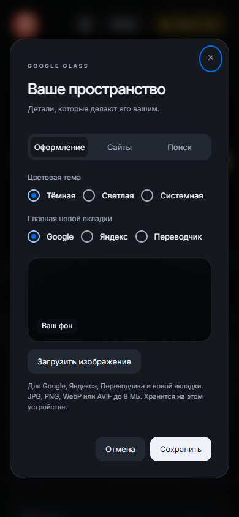

</details>

### Google Translate

| Dark | Light |
| --- | --- |
|  | 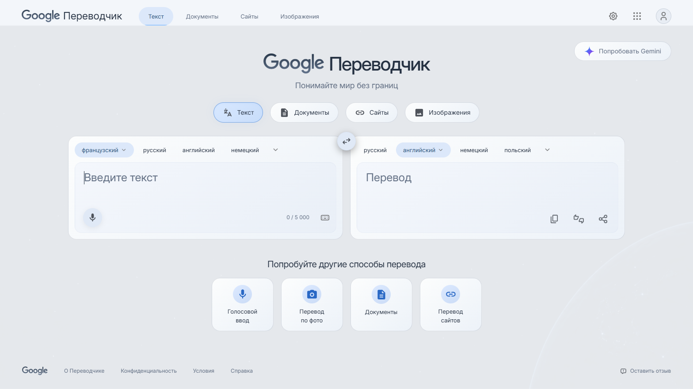 |

<details>
<summary>Translate on mobile and its live translation result</summary>

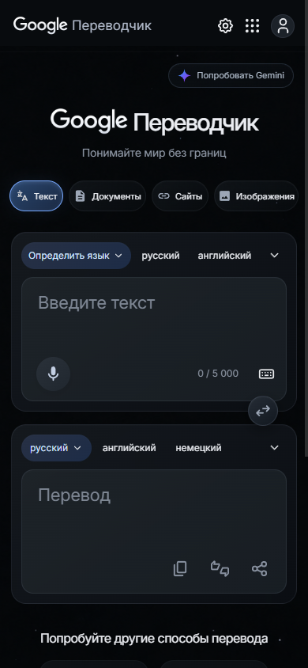

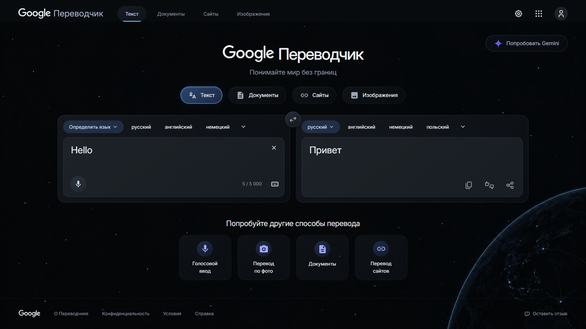

</details>

### Gmail scrolling repair

This anonymized native-layout fixture shows the dark toolbar after scrolling, the unframed Gmail logo, readable icons and corrected Compose gradient. The user's private inbox capture is excluded from the repository.

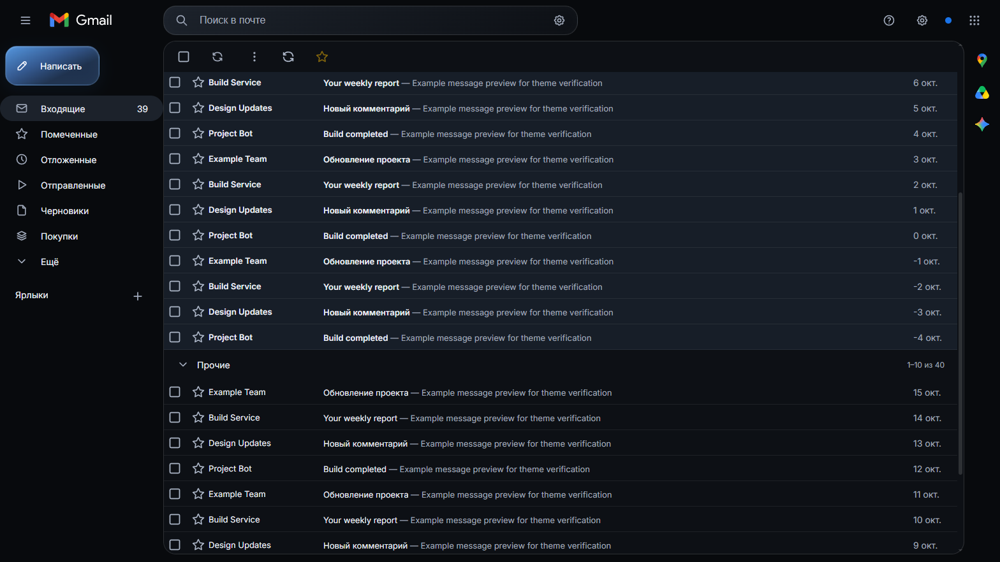

### Dark and light themes

| Dark | Light |
| --- | --- |
| 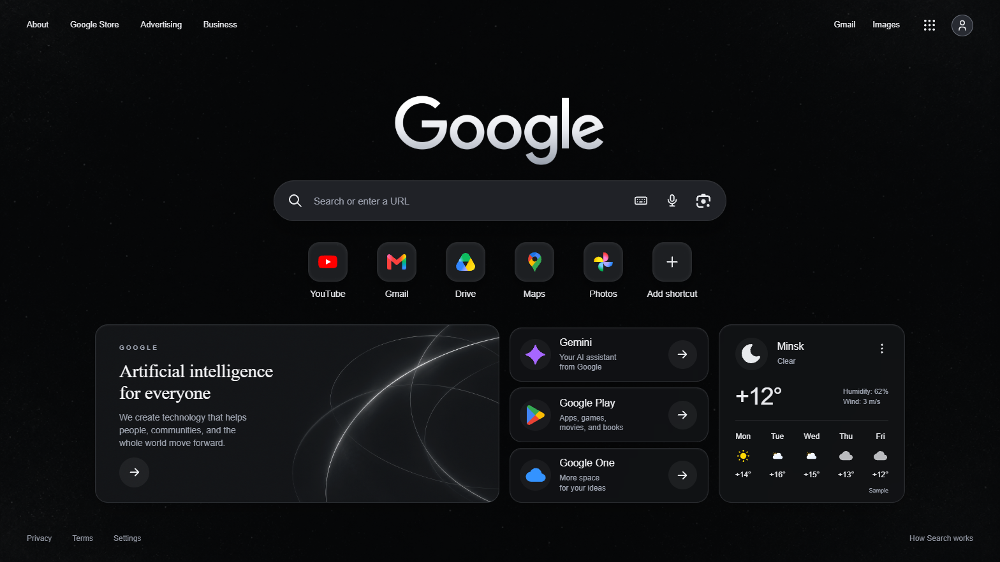 | 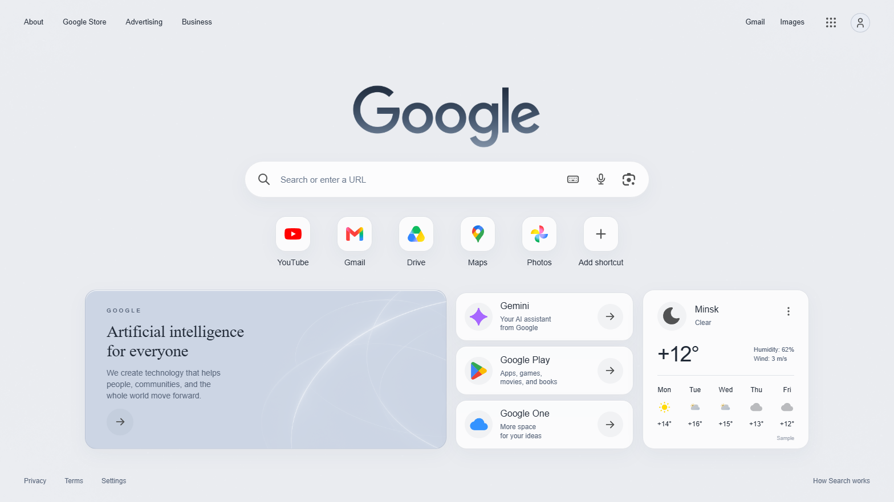 |

### Custom background

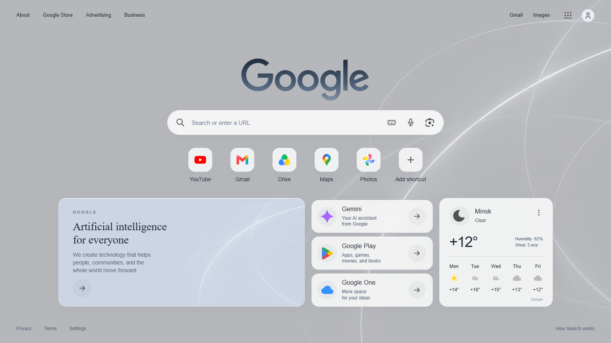

### Google search results

The reference preview reproduces the supplied Glusk example. On Google, the extension styles the site's actual results.

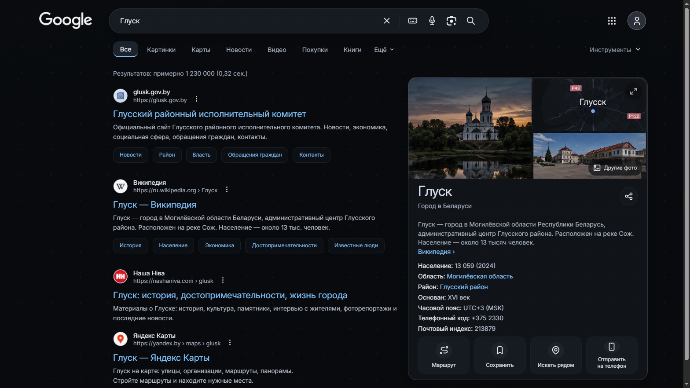

### Country selector

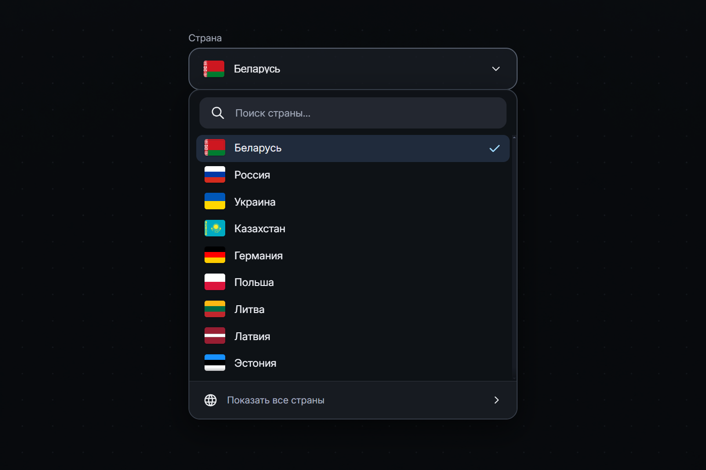

### Settings

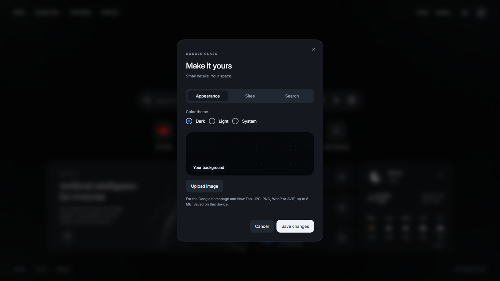

<p align="center">
  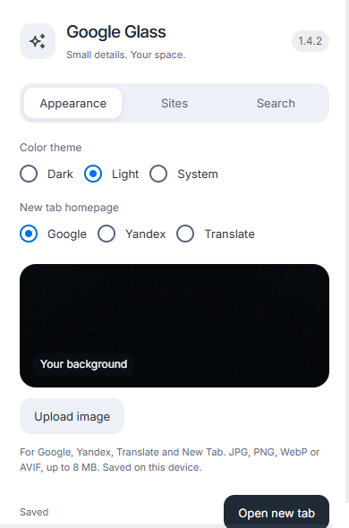
  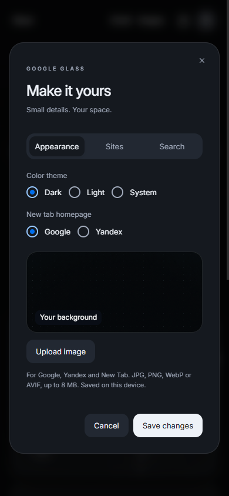
</p>

<details>
<summary>YouTube theme — live signed-out QA capture</summary>

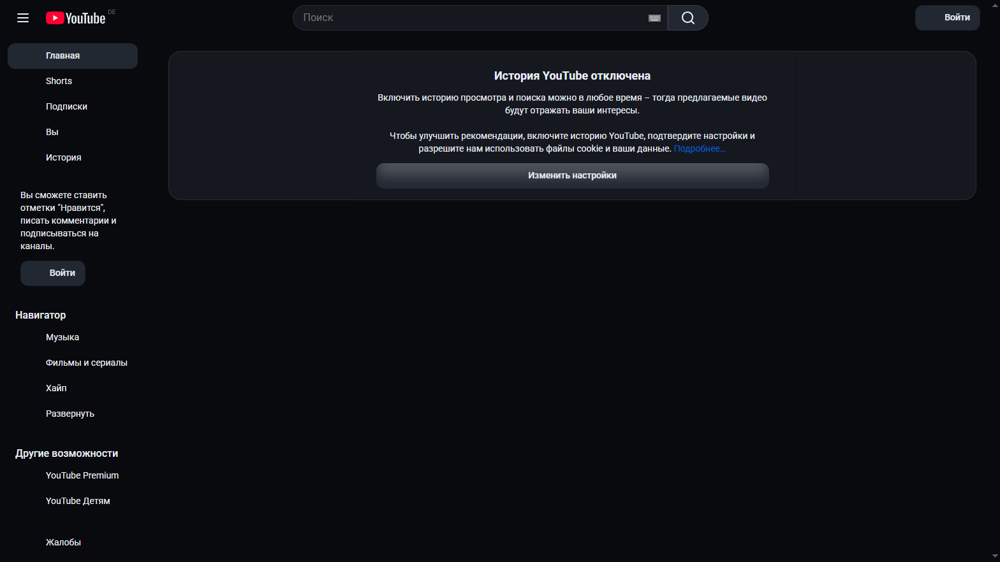

</details>

## What changed in 1.2

- Removed the homepage side copy and promotional footer text. The Google wordmark now uses a silver gradient shaped by the official logo.
- Uses the real account image exposed by Google's native header. The last observed image is also shown on New Tab; a neutral icon is used when unavailable. Visiting a signed-out Google page clears the cached image.
- Upload a JPG, PNG, WebP or AVIF background for the homepage and New Tab. Images are resized to at most 2560 pixels, encoded as WebP and stored on this device. Original uploads may be up to 8 MB.
- Actual HeroUI Modal, Input, Button, Switch, Tabs, RadioGroup, Popover, Listbox and related controls, with appearance animations and reduced-motion support.
- Dark, light and system color modes. Inputs have no active outline or focus ring; buttons retain keyboard focus indicators.
- Independent Google, YouTube and Gmail switches in the control panel. Google homepage, results and AI Mode can also be switched separately.
- Scoped styles preserve native Google results, AI responses, citations, YouTube playback and Gmail controls. The extension does not replace their data.
- Manifest CSS and a small startup script apply the native themes before rendering. Results and Gmail use small native adapters. YouTube has its own locally bundled HeroUI interface. Google and YouTube SPA transitions update the theme automatically.

Existing features remain: English/Russian UI, searchable country selectors with 252 countries/territories, Google search and URL navigation, up to eight editable shortcuts, an apps launcher, Lens and optional voice input, and opt-in Open-Meteo weather.

## Controls

Version **1.2.3** repairs the Gmail issues visible in the supplied live inbox screenshot. The theme now adapts neutral application surfaces outside the reading pane, including full-height sidebars, outer gutters, section headings, the Workspace rail and footer. Monochrome SVG and masked icons gain contrast while colored icons retain their colors. Gmail logo and font URLs use Chrome's absolute extension-resource format, fixing broken images and font loading. Gmail's unread-first layout and its native controls remain in place.

Version **1.2.2** adds HeroUI skeletons for loading YouTube video metadata and thumbnails, including infinite-scroll items. Skeletons follow the card dimensions, respect reduced motion and disappear when the real content arrives. Failed thumbnails stop animating and keep the video link available. It also retains the 1.2.1 repairs for missing titles, repeated sidebar entries and inactive menus: original interactive elements stay aligned with their HeroUI styling so mouse and keyboard actions reach YouTube's native handlers.

YouTube now uses locally bundled HeroUI navigation, search, category controls, featured videos, video cards, and Shorts. The featured shelf uses the first four native feed videos when at least eight are available. Video titles, thumbnails, channel links, filters, and action menus come from YouTube; empty feeds keep YouTube's own message. Switching YouTube off restores its original interface.

Gmail's dark theme covers the inbox, category tabs, sidebar, reading pane, HTML messages, attachments, compose/reply windows, and settings menus. Unified panels, muted toolbars, distinct unread rows and blue accents follow the reference. Rendered email colors are adapted against their actual backgrounds: neutral light surfaces become dark, and low-contrast text becomes readable while readable brand colors remain intact. Images and authored inline styles are preserved. Turning the theme off or choosing light mode removes the email overrides. Gmail keeps its configured inbox and reading-pane layout. Both sites also support the light and system preferences.

The Sites switches have fixed tracks and contained thumbs in both states, with keyboard focus and Space support.

Version **1.3.0** adds the Yandex homepage and New Tab provider choice. Multiple settings edits now retain the latest draft, and Escape closes a nested selector before its settings dialog.

Pin Google Glass in Chrome's Extensions menu. Its popup has **Appearance**, **Sites** and **Search** tabs. Popup changes save immediately. Homepage **Settings** opens the same controls in a HeroUI modal; choose **Save changes** to commit that form.

New Tab remains controlled by the extension while it is enabled, regardless of the Google website switch. Chrome adds its own extension-attribution / Customize Chrome footer outside the extension document. This browser-owned footer cannot be hidden by the extension. The extension name is now simply **Google Glass**.

## Scope and privacy

Supported Google country domains are listed in `extension/manifest.json`. Themes cover `/`, `/webhp`, `/search`, `/ai` and `/aimode`, plus `youtube.com` / `www.youtube.com` and `mail.google.com`. The Yandex theme covers supported homepage roots only. Consent and CAPTCHA routes are excluded. Specialized widgets may keep some native styles as these sites change their markup.

Translate uses a separate site toggle. Its custom text interface covers the root page on `translate.google.com` / `translate.google.ru`, with native Google document/image/site workflows retained. It does not theme Google consent pages or CAPTCHA routes.

The extension uses `storage`, content-script access to those sites, and the two Open-Meteo hosts for optional weather. It does not request cookies, history, geolocation, identity or access to arbitrary sites. There is no analytics or query logging. Backgrounds, settings, shortcuts, avatar URL and weather cache stay in local extension storage. Avatar images are loaded from the URL already exposed by Google. The selected theme name is also cached in supported sites' local storage to select the initial page background. Weather sends the entered city and IP address to Open-Meteo only when enabled. Chrome's optional speech recognition may process audio through its own service.

## Source and development

```text
extension/              Load this directory in Chrome
  boot.js / boot.css    Early preferences, route handling and paint protection
  app.js / page.css     Homepage and New Tab interface
  content.js            Isolated Google homepage integration
  results-content.js    Native results and AI DOM annotations
  results.css           Native Google / AI theme
  yandex-ui.js          Bundled HeroUI Yandex homepage
  yandex-content.js     Isolated native Yandex homepage integration
  yandex.html           Yandex reference preview
  translate-ui.js       Bundled HeroUI Google Translate interface
  translate-content.js Bridge to Google's native translation engine
  translate.html        Translate reference preview / New Tab option
  sites.css             YouTube / Gmail themes
  gmail-content.js      Local contrast adaptation for Gmail UI and rendered mail
  youtube-content.js    Native YouTube feed and navigation integration
  youtube-ui.js         Locally bundled HeroUI YouTube components
  youtube.css           Isolated YouTube component styles
  control-panel.js      Toolbar popup integration
  ui.js / ui.css        Locally bundled React and HeroUI
src/                    Editable HeroUI components and styles
scripts/                Build, browser checks, preview and packaging
qa/                     Screenshots, comparisons and verification reports
```

Development in the full project workspace requires Node.js 22+ and Python 3 for ZIP packaging. On Windows:

```powershell
npm.cmd ci
npm.cmd run build
npm.cmd run dev
npm.cmd run check
npm.cmd test
npm.cmd run package
```

Use `npm` on macOS/Linux. The local homepage preview is `http://127.0.0.1:4173/`; the supplied search and selector references are reproduced at `/results.html` and `/selectors.html`. Browser-only features require installation.

Tests use native Chrome DevTools Protocol in an isolated Chrome for Testing / Chromium profile. Set `CHROME_BINARY` to a suitable executable if needed. They check installed extension flows, native-site fixtures, first-frame styling, real avatar propagation, image upload, independent site switches, light mode, modal dismissal, search region, accessibility restoration and dynamic results. Live signed-out YouTube and Google AI entry-page checks are separate. Gmail and AI response/composer checks use fixtures because the test profile has no signed-in Gmail or eligible AI account. See [design-qa.md](design-qa.md).

Run `npm run test:sites` for the YouTube/Gmail and switch checks. Screenshots and results are saved under `qa/sites-*`. These screenshots use representative native markup and the existing bundled fixture images; installed YouTube always uses the user's actual feed imagery.

Run `node scripts/gmail-theme-test.mjs` for plain and formatted email contrast, preserved brand colors, dynamic content, light-mode restoration and draft retention. The full `npm test` includes these checks. The Gmail review and before/after screenshots are in `qa/gmail-theme-review.md`. Signed-in Gmail is not available in the isolated test profile; fixtures do not establish fidelity for every live Gmail view or contrast over background images.

`node scripts/gmail-layout-test.mjs` additionally checks the unread-first layout reported by the user, native sidebar/rail/heading colors, actual logo and font resource loading, icons, trusted controls, responsive width and complete restoration. Its anonymized before/after captures are `qa/gmail-layout-*`; the user's private inbox screenshot is not included in the repository.

`npm run test:yandex` checks Yandex search, service assets, keyboard, shortcut editing, mobile dialogs, provider switching, shared background upload, nested selectors, hourly weather and native-page restoration. See [the Yandex reference comparison and review](qa/yandex-design-qa.md).

`npm run test:translate` checks the Translate layout, keyboard, language search/swap, input limit, provider settings, backgrounds, first paint and native integration with deterministic fixtures. `npm run test:gmail-scroll` covers the exact supplied logo DOM, scrolling toolbar layers, Compose gradient and native icons. Both are included in the full test suite. `npm run test:translate-live` separately verifies real text translation, language changes, trusted mouse clicks, copy/share, swapping, native rating/feedback, document/image file choosers and website entry on current public Google Translate. Voice start/stop, results and error handling use controlled SpeechRecognition callbacks; no microphone audio is recorded by QA. See [the 1.4 review](qa/translate-gmail-design-qa.md).

`node scripts/live-youtube-check.mjs` checks current public YouTube video components, video menus, the Share modal and the signed-out header dropdown. It uses a public channel's components on a home-route test surface, without a signed-in profile. Evidence is saved under `qa/youtube-fixed-live-*` and `qa/youtube-live-test-results.json`.

## Credits

HeroUI 2.8.10 and React 18 are bundled locally; MIT notices are in `extension/HEROUI-LICENSE.txt` and `extension/ui.js.LEGAL.txt`. Inter and its SIL OFL are in `assets/fonts`; flag-icons and its MIT license are in `assets/flags`. Product logos use the SVG Logos collection, icons use Tabler / Simple Icons / Meteocons, the Google wordmark uses Google's official image, and decorative artwork was generated from the user's references. Prompts are included in `qa/asset-prompts.md` and `qa/results-asset-prompts.md`. Reference previews are labeled examples; installed Google pages display native results.

This is an independent project, unaffiliated with Google or HeroUI.

Yandex product marks belong to Yandex. Bundled service asset URLs are recorded in `extension/assets/yandex-sources.json`; the wordmark is the 2021 Cyrillic artwork attributed to Yandex. News thumbnails are illustrative Unsplash photographs. Particle-wave and Plus illustrations were generated for this project; see [asset prompts](qa/yandex-asset-prompts.md). The project is also unaffiliated with Yandex.

Translate uses Google's product mark, the existing official Google wordmark, the Simple Icons Gemini silhouette and Material Symbols / Tabler icons. Material Symbols' Apache 2.0 license is included in `extension/TRANSLATE-ICONS-LICENSE.txt`. The language catalogue was read from public Google Translate on 2026-10-16. Background asset and generation prompt: [Translate asset notes](qa/translate-asset-prompts.md).
