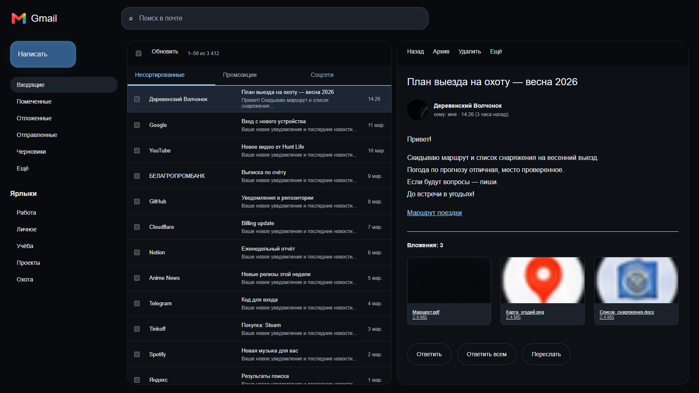
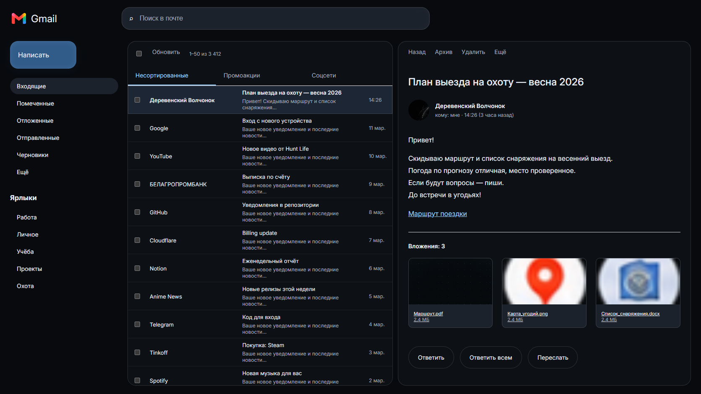
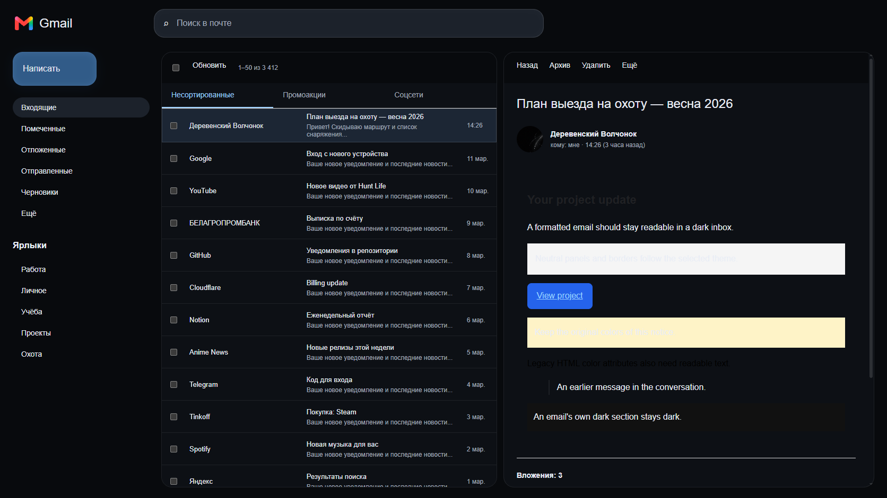
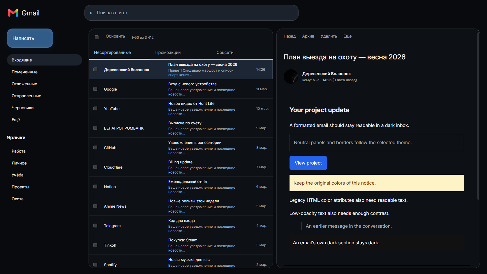
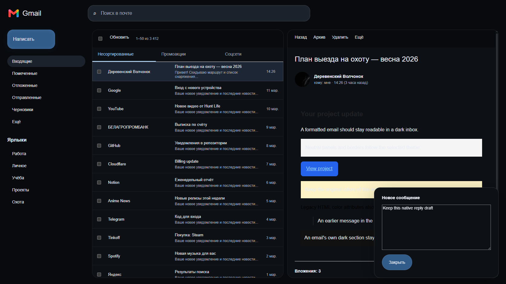
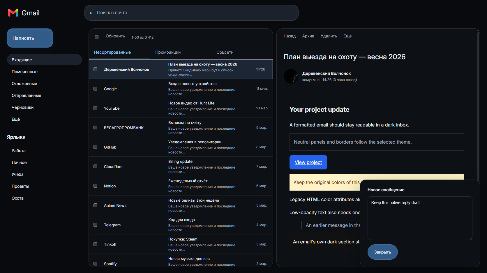
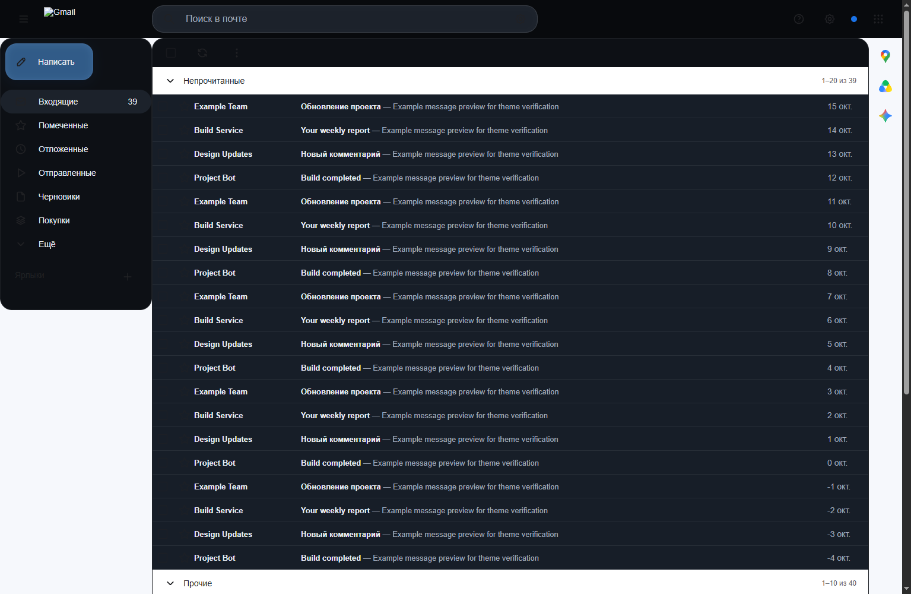
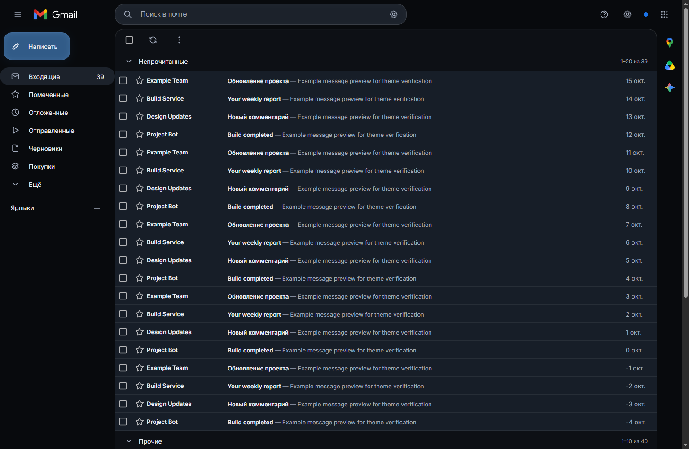

# Gmail dark-theme review — 1.2.2

Reviewed the extension's current inbox, reading pane and compose styling at 1672 × 941. Captures use controlled, representative Gmail markup and bundled assets; no signed-in account or private mail was accessed. They demonstrate specific CSS failures and their repairs, rather than a complete audit of live Gmail. The supplied reference establishes the near-black surfaces, blue compose button, subtle panel edges and readable message hierarchy.

1. **Inbox and reading pane.** Toolbars used a different dark background from their panels, nested containers received duplicate borders/radii, and unread subjects lacked a clear weight distinction. Toolbars now share their panel background, nested containers stay flat, and unread sender/subject text has stronger weight. Gmail's existing layout remains in place.

   
   

2. **Opened HTML email — high impact.** The original blanket white-text selector missed headings and legacy font colors, while leaving gray and colored backgrounds unchanged. The captured example had black headings on dark surfaces, pale text on a white panel, pale text on a yellow notice, and an altered blue button label. The new local adapter reads rendered colors, darkens neutral light surfaces and corrects low-contrast text against the resulting background. Readable authored brand colors and images remain intact. All nine tested text/background pairs exceed 4.5:1, including translucent text; these measurements do not establish accessibility compliance for arbitrary emails, images, gradients or every Gmail UI control. The original before capture predates the additional translucent-text regression case.

   
   

3. **Compose/reply.** Compose fields had harsh native light-theme borders. The theme now provides subtle field edges, rounded textarea corners and separate raised compose-header styling. The original controls and draft remain functional. Message adaptation excludes editable compose content and never reads, stores or transmits message text. Light mode and disabling Gmail remove the adaptation without overwriting authored color/background declarations.

   
   

Verification: `node scripts/gmail-theme-test.mjs` checks plain/HTML mail, legacy attributes, quoted text, brand colors, live style/content changes, hidden reading panes, light-mode/disabled restoration and draft retention. Results: [gmail-theme-test-results.json](gmail-theme-test-results.json). Existing site checks also cover inbox/attachment styling, logo palette, switches and a 390px viewport.

Remaining limit: an authenticated Gmail tab was unavailable. Native Gmail settings, all alternate inbox layouts and real compose/send flows still require signed-in verification. The extension does not create a new reading-pane layout or fabricate mail to match the reference.

## Screenshot-driven repairs — 1.2.3

The user's subsequent live screenshot showed gaps missed by the original split-pane fixtures: white outer gutters and Workspace rail, a partial rounded sidebar, unreadable section/footer labels and monochrome icons, and a broken Gmail wordmark. The private screenshot remains in the conversation and is not copied into Git. A new anonymized unread-first fixture reproduces these layout and asset failures.

1. **Application surfaces.** Native neutral light containers now adapt to the palette regardless of Gmail's changing class names. Dark text is checked against the resulting background. Navigation and complementary sidebars use the page surface and avoid the earlier broad `.AO` rounded-panel rule. Section headings and footer text stay readable.
2. **Assets.** The earlier relative logo/font URLs requested `https://mail.google.com/mail/u/0/assets/...`, confirmed by the before-run network log. They now use the [Chrome extension-resource URL format](https://developer.chrome.com/docs/extensions/develop/concepts/content-scripts#access-other-files). The regression requires successful PNG responses from the installed extension and a loaded HGInter font, rather than only checking the CSS URL string.
3. **Icons and controls.** Neutral masked/SVG icons gain contrast; branded colors and checked/starred states remain native. Trusted checkbox, section-collapse, settings and compose interactions are verified. The adapter excludes editable content, restores its annotations in light mode/off, and retains the draft.

Additional captures: [compose](gmail-layout-compose.png), [light](gmail-layout-light.png), [mobile](gmail-layout-mobile.png). Results: [gmail-layout-test-results.json](gmail-layout-test-results.json). These checks reproduce the failures visible in the supplied screenshot; they do not claim a live signed-in account test or exact coverage of every Gmail widget.
