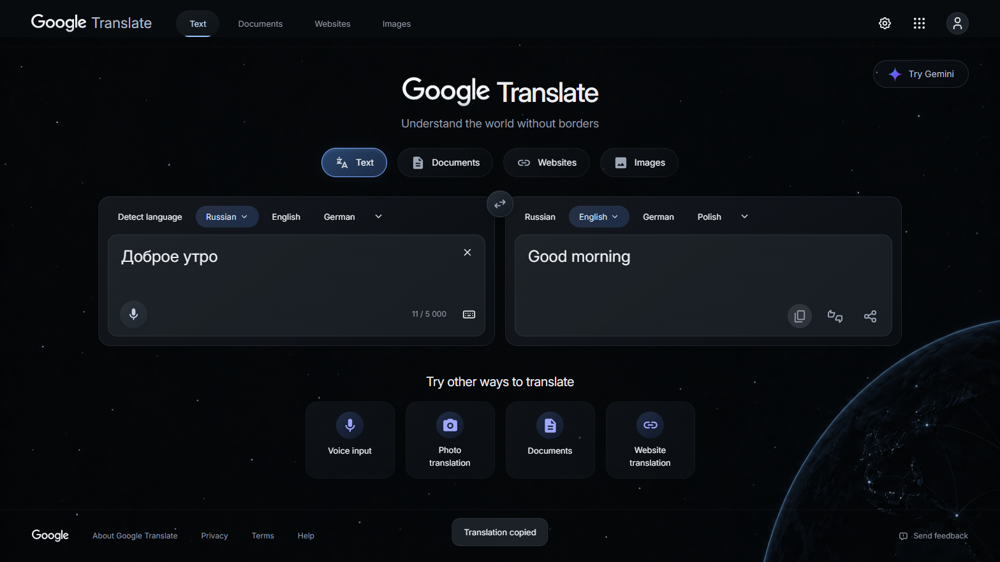

# Translate startup and .ru domain review — 1.4.3

The reported URL was tested directly with the extension installed in an isolated Chrome for Testing profile. `https://translate.google.ru/` stayed on `.ru` and served the Russian native interface. This review does not substitute a `.com` or localhost result for a `.ru` check.

## Reproduction

On two initial `.ru` probes, trusted input put `Hello` into both editors. Google's subsequent initialization reset its native textarea to empty; the bridge then propagated that empty value into the themed editor. No translation was produced. A later probe succeeded, establishing an intermittent startup ordering problem rather than a missing `.ru` manifest match. Local menus could open throughout.

The previous bridge treated every native snapshot as authoritative, including this initialization reset. It also sent early native language clicks only once, even if their handlers had not initialized.

## Repair

The bridge keeps the latest requested text and source/target languages in memory until Google's native query state acknowledges them. While pending, initialization resets cannot replace the visible choices or text. Unacknowledged commands are retried at most every 500ms for up to ten seconds, using the current native textarea rather than a detached reference. Only the latest command for each control remains pending. Once acknowledged, retries stop and native state updates remain authoritative. Back/Forward, hash navigation and unmount cancel pending commands.

No new endpoint, stored translation text or extension permission was introduced. Copy/Share retain the existing denied-permission fallback; links and Translate navigation now preserve the active `.ru`/`.com` origin. The component layout, colors and background are unchanged.

## Regression evidence

`scripts/translate-startup-test.mjs` loads a deterministic delayed-controller fixture through the installed `.ru` content-script path. It replaces/resets the native textarea after the user types and before native handlers are attached. With the **1.4.2 bridge**, the first assertion fails: expected `Early input`, got an empty string. With the repaired bridge, all six checks pass: retained input, retained languages, replay of the latest text/pair, cessation of acknowledged retries, clear and no runtime errors. Fixture output is explicitly labeled and is not a production translation.

[Delayed-startup results](translate-startup-results.json).

## Live verification

The parametrized live suites run against **both** `translate.google.ru` and `translate.google.com`. The `.ru` checks use trusted pointer/keyboard input and Google's actual engine. They cover immediate input on the root URL, language search, Russian → English (`Доброе утро` → `Good morning`), actual clipboard contents, Share retaining the `.ru` origin, reverse translation, apps, settings/save, keyboard, clear, native rating/feedback without submission, native document/image file choosers, website URL entry and return to text mode.

[Live .ru control results](translate-controls-results-ru.json) · [Installed .ru root-page results](translate-installed-results-ru.json).

Final results: **115** checks in `npm test`, **30** live `.com` checks and **24** `.ru` checks passed. Manifest/resource checks also enforce the `.ru` injection and stylesheet access paths.



The capture was opened and visually checked at 1568 × 882, device scale factor 1, dark English UI. The public signed-out site was tested; the user's existing profile was not inspected. Microphone callbacks are simulated, and file processing/third-party website translation are not exhaustively verified. A `.com` test attempt initially stalled on Google's consent-save navigation; the subsequent run is recorded separately from the extension regression.

```powershell
npm.cmd test
npm.cmd run test:translate-live
npm.cmd run test:translate-ru
npm.cmd run package
```

Reload the updated extension, confirm **1.4.3**, then refresh existing Translate tabs. Compiled installation folder: `D:\Projects\google\extension`.
