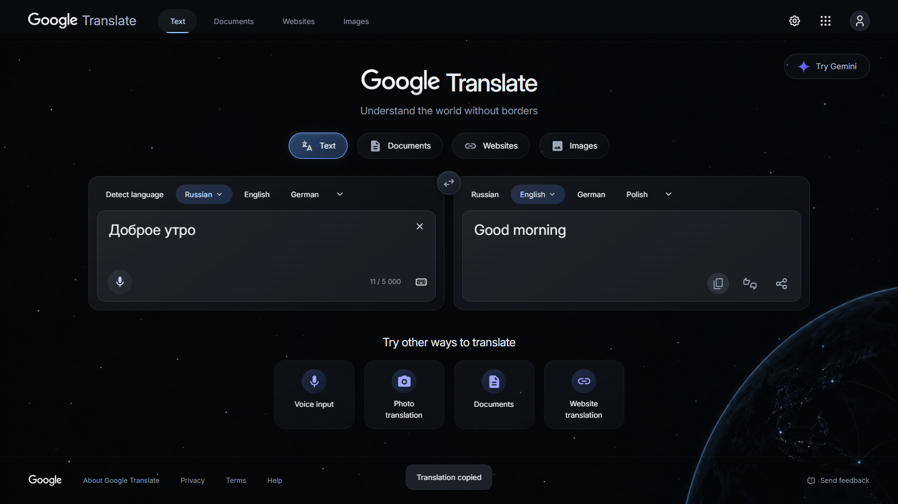

# Translate state and Copy review — 1.4.2

final result: passed

The user reported a concrete mismatch: clicking changed the URL to `?sl=ru&tl=en` while the themed interface remained unchanged, and Copy failed. The prior 1.4.1 fix covered body-level interaction isolation. It did not cover the separate state and clipboard cases found here.

## Comparison with the Google homepage

`extension/app.js` controls the homepage's visible state directly through scoped DOM events. Its settings controller reads its current state when applying changes. Translate additionally depends on a live native engine behind its custom interface. That bridge only observed DOM mutations and preferred native tab attributes over URL state. Google can change history and textarea **properties** without a matching observed mutation, so the bridge could leave selected languages, text, results and enabled actions stale.

The live comparison used `https://www.google.com/` and `https://translate.google.com/` in the same isolated Chrome profile. Trusted pointer input opened Google's apps menu and the shared HeroUI settings modal; Escape dismissed it. The corresponding Translate apps, language selection, settings/save, keyboard, clear and input flows then passed. [Results](translate-installed-results.json).

## Reproductions and fixes

| Reproduced failure | Correction | Evidence |
| --- | --- | --- |
| Native history/URL and textarea value changed; themed ru/en labels and text stayed stale | Read explicit `sl`/`tl` first; notify on navigation/history/input; seed subscribers with the current snapshot; compare native value properties while the theme is mounted | Deterministic URL-only, value-only and Back/Forward checks |
| Native selected-tab attributes lagged the URL | Treat explicit query parameters as authoritative; do not reload an already-correct language URL | ru→en selected pills and native URL remain synchronized |
| Copy rejected when the site's Clipboard API permission was denied | Use selected-text copy as a fallback, restore focus/selection, show success only after a successful write | Permission-denied Copy/Share tests and actual clipboard reads |
| Clearing could retain a previous native result | Ignore native result text when the source is empty | Clear immediately resets output and disables empty-result copy |

`scripts/translate-state-test.mjs` failed against the previous bridge on a history/value-only change: the URL became `sl=en&tl=de`, while the interface retained ru/en and the previous text. After synchronization was fixed, the same test exposed the Copy denial. It passes after both corrections. Its evaluations do **not** manufacture user activation; controls receive trusted CDP mouse input.

The native-value comparison runs only while the custom Translate surface is mounted and stops on unmount. It is signature-deduplicated and does not save or transmit translation text. No new extension permission or unofficial translation endpoint was added. The fallback copies only the user-requested text/link and does not read the clipboard in production.

Platform references: [Chrome content-script isolation](https://developer.chrome.com/docs/extensions/develop/concepts/content-scripts) and [extension clipboard APIs and direct-copy compatibility](https://developer.mozilla.org/en-US/docs/Mozilla/Add-ons/WebExtensions/Interact_with_the_clipboard). The permission-denied behavior above was verified in Chrome rather than inferred from documentation alone.

## Live verification

Actual Google Translate received `Доброе утро`, with `sl=ru&tl=en`. The visible source pill showed Russian, target showed English, and Google returned **Good morning**. With the site's Clipboard API permission explicitly denied, trusted Copy wrote the new English result, replacing the previous Russian translation. Share also copied a reusable URL through the same fallback.



Capture: 1568 × 882 CSS pixels, device scale factor 1, dark English UI, installed extension over current public Google Translate. It was opened and visually checked; no component layout/style changes were made in this repair. The previous [source/render comparisons](../design-qa.md) remain the visual baseline.

## Results and scope

- `npm test`: **109** checks across ten suites, including [8 state/clipboard regressions](translate-state-results.json), passed.
- `npm run test:translate-live`: **29** checks passed: [6 live engine checks](translate-live-results.json), [15 live/control checks](translate-controls-results.json), [8 installed-page/Google comparison checks](translate-installed-results.json).
- Copy/Share writes happen **before** clipboard-read permission is granted for verification. Tests no longer pre-grant write permission before the tested actions.
- No runtime exceptions or React console errors in the exercised flows. Voice callback, native file-processing and signed-in profile limits remain documented in the root report.

The user's existing browser profile was not inspected. The reproduced failures and the live ru→en/copy flow establish the corrected behavior in the installed test profile; they are stronger evidence than a local-preview check or a URL-change-only assertion.

## Reproduce / update

```powershell
npm.cmd run build
npm.cmd test
npm.cmd run test:translate-live
npm.cmd run check
npm.cmd run package
```

Reload the updated extension at `chrome://extensions`, confirm **1.4.2**, then refresh/reopen Translate. Existing tabs retain old injected code until refreshed.
