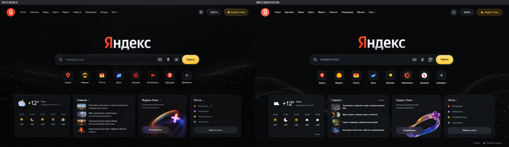
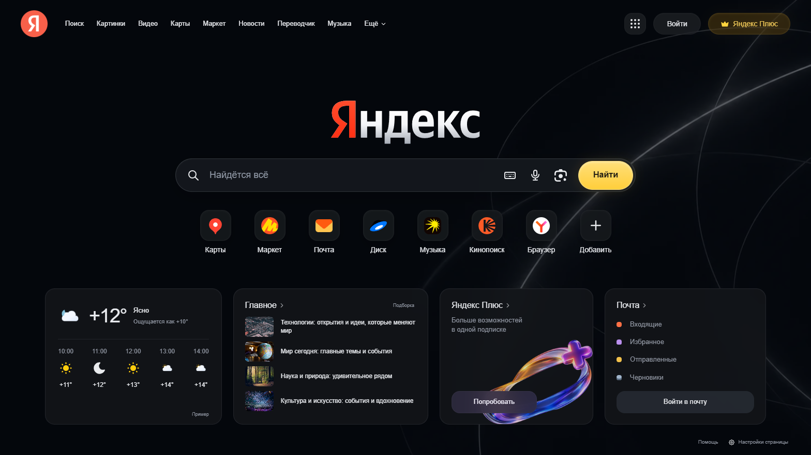

# Yandex homepage review — 1.3.0

Date: 2026-10-15. Visual review: passed for the requested homepage. Functional results: [Yandex checks](yandex-test-results.json).

## Reference and render

The supplied 1567 × 882 reference is saved as [reference-yandex.png](reference-yandex.png). The implementation was captured in native Chrome for Testing at 1568 × 882, with the reference normalized by one pixel for comparison.

Focused comparisons: [search and shortcuts](compare-yandex-hero.png), [four information cards](compare-yandex-cards.png).

The desktop header, centered wordmark, search pill, shortcut row and four-card grid match the reference's placement and proportions. The wordmark uses the actual Yandex silhouette with red and silver gradients. Search, buttons, cards, popovers, selectors, tabs and animated dialogs are actual locally bundled HeroUI components. Native account sign-in and service links open Yandex's own services.

## Repairs verified

- Corrected HeroUI card-body padding and clipped illustration overflow; no internal Plus-card scrollbars.
- Corrected retained settings callbacks so changing the theme cannot restore an earlier homepage provider or discard another field edit.
- Escape closes an open selector before the parent settings dialog and returns focus to its trigger.
- A separate New Tab container and generation check prevent stale asynchronous mounts during provider changes.
- Native Yandex content stays concealed while the themed homepage loads. Disabling the site or navigating to results restores native accessibility attributes and scrolling.

## Variants

| Mobile homepage | Mobile settings |
| --- | --- |
|  |  |

At 390 × 844 the shortcuts wrap into two rows, information cards stack, and the modal stays within the viewport. Dark, light and system preferences and reduced-motion settings use the existing shared controls. Uploaded backgrounds persist across reloads and appear on Yandex New Tab pages.

## Intentional differences

Current bundled service marks differ from some historical icons in the reference. Decorative particle waves and Plus art were generated from the reference's direction, rather than copied pixel for pixel. The weather card explicitly labels its sample; optional live data comes from Open-Meteo. News items are labeled selected topics with real search links. Mail opens Yandex Mail without inventing an unread count. A small footer gives access to help and settings. No unresolved layout or interaction blocker remains for this homepage.

## Coverage and limits

The installed-extension tests cover images, focused-input styling, on-screen keyboard, shortcut validation/add/edit/delete, responsive dialogs, Escape, Google/Yandex switching, light mode, multiple settings edits, nested selectors, background upload and persistence, hourly weather, native-page restoration, first paint and Unicode search routing. Weather and native Yandex page checks use deterministic response fixtures. Mailbox contents, subscription state, voice recognition and authenticated Yandex account flows are handled by the native services and were not exercised with a signed-in account.

Evidence: [test results](yandex-test-results.json), [first-frame samples](yandex-first-paint.json), [asset sources](../extension/assets/yandex-sources.json), [illustration prompts](yandex-asset-prompts.md).

Final validation: `npm.cmd test` passed all 84 browser checks across seven suites; `npm.cmd run check` passed manifest, local resources, JavaScript syntax and MV3 CSP checks; `npm.cmd audit --omit=dev` reported zero vulnerabilities. An earlier YouTube test timeout came from the fixture fulfilling only the first failed-thumbnail request; the fixture now also fulfills the themed image's later request. The final full run passed without retries.
